# Quiet status feedback — visual review

**126 before/after pairs.** Baseline `02b6ed2d`; after uses this PR’s UI, including source revision `17eda80f`. All screenshots use disposable local fixtures. Organization-scoped product requests target `showpilot-demo-nov04`; the administrative fixture also contains a synthetic negative-control organization. No real org data is read or changed.

The 27 core web pages are captured at 1440×900 and 320×900, with zero horizontal overflow. Additional frames cover all Settings sections, access/crew/report administration, onboarding, song/device detail, valid public crew scheduling, graphics-disabled setup, media output, and Template Studio. Desktop adds local-off, unreachable, and active cases plus Settings/API preparation.

Mobile frames render actual React Native components through Expo Web at 390×844. The before sign-in frame uses the original `02b6ed2d` AuthScreen; the after frame uses the changed component. The fixture holds the sign-in request: the original visible “Signing in…” is replaced by one quiet spinner. Exports and type checks cover iOS and Android; these screenshots do not claim a physical-device/native-installer test.

Desktop and the packaged offline shell use read-only IPC fixtures. No hardware commands or remote migrations are run. The Confidence error badge is the same missing-hardware fixture response before and after; it is unrelated to the removed local-show panel.

Human attendance/assignment responses, domain dates, message times, explicit destructive confirmation dialogs, and real show transport states remain. Browser clocks and generated fixture call/start times vary between captures. Loading/recovery states beyond the static frames are covered by the behavioral tests.

[String audit](string-audit.md) · [Screens manifest](screenshots.json) · [320 px measurements](web-320-screens.json) · [1440 px measurements](web-1440-screens.json) · [Mobile measurements](mobile-screens.json) · [Additional screens](extra-screens.json) · [Settings measurements](settings-screens.json)

| Screen / scenario | Before | After |
| --- | --- | --- |
| account-menu | [Before](before/account-menu.png) | [After](after/account-menu.png) |
| admin-1440 | [Before](before/admin-1440.png) | [After](after/admin-1440.png) |
| admin-320 | [Before](before/admin-320.png) | [After](after/admin-320.png) |
| admin-access | [Before](before/admin-access.png) | [After](after/admin-access.png) |
| admin-crew | [Before](before/admin-crew.png) | [After](after/admin-crew.png) |
| admin-reports | [Before](before/admin-reports.png) | [After](after/admin-reports.png) |
| assignments-1440 | [Before](before/assignments-1440.png) | [After](after/assignments-1440.png) |
| assignments-320 | [Before](before/assignments-320.png) | [After](after/assignments-320.png) |
| board-1440 | [Before](before/board-1440.png) | [After](after/board-1440.png) |
| board-320 | [Before](before/board-320.png) | [After](after/board-320.png) |
| chat-1440 | [Before](before/chat-1440.png) | [After](after/chat-1440.png) |
| chat-320 | [Before](before/chat-320.png) | [After](after/chat-320.png) |
| checkin-1440 | [Before](before/checkin-1440.png) | [After](after/checkin-1440.png) |
| checkin-320 | [Before](before/checkin-320.png) | [After](after/checkin-320.png) |
| crew-chat-1440 | [Before](before/crew-chat-1440.png) | [After](after/crew-chat-1440.png) |
| crew-chat-320 | [Before](before/crew-chat-320.png) | [After](after/crew-chat-320.png) |
| dashboard-audio-1440 | [Before](before/dashboard-audio-1440.png) | [After](after/dashboard-audio-1440.png) |
| dashboard-audio-320 | [Before](before/dashboard-audio-320.png) | [After](after/dashboard-audio-320.png) |
| dashboard-devices-1440 | [Before](before/dashboard-devices-1440.png) | [After](after/dashboard-devices-1440.png) |
| dashboard-devices-320 | [Before](before/dashboard-devices-320.png) | [After](after/dashboard-devices-320.png) |
| dashboard-prod-manager-1440 | [Before](before/dashboard-prod-manager-1440.png) | [After](after/dashboard-prod-manager-1440.png) |
| dashboard-prod-manager-320 | [Before](before/dashboard-prod-manager-320.png) | [After](after/dashboard-prod-manager-320.png) |
| dashboard-tech-manager-1440 | [Before](before/dashboard-tech-manager-1440.png) | [After](after/dashboard-tech-manager-1440.png) |
| dashboard-tech-manager-320 | [Before](before/dashboard-tech-manager-320.png) | [After](after/dashboard-tech-manager-320.png) |
| desktop-rundown-active | [Before](before/desktop-rundown-active.png) | [After](after/desktop-rundown-active.png) |
| desktop-rundown-off | [Before](before/desktop-rundown-off.png) | [After](after/desktop-rundown-off.png) |
| desktop-rundown-unreachable | [Before](before/desktop-rundown-unreachable.png) | [After](after/desktop-rundown-unreachable.png) |
| desktop-settings-api | [Before](before/desktop-settings-api.png) | [After](after/desktop-settings-api.png) |
| device-detail | [Before](before/device-detail.png) | [After](after/device-detail.png) |
| graphics-disabled | [Before](before/graphics-disabled.png) | [After](after/graphics-disabled.png) |
| graphics-preview | [Before](before/graphics-preview.png) | [After](after/graphics-preview.png) |
| media-output | [Before](before/media-output.png) | [After](after/media-output.png) |
| mobile-asset-inventory | [Before](before/mobile-asset-inventory.png) | [After](after/mobile-asset-inventory.png) |
| mobile-audio | [Before](before/mobile-audio.png) | [After](after/mobile-audio.png) |
| mobile-chat | [Before](before/mobile-chat.png) | [After](after/mobile-chat.png) |
| mobile-checkin | [Before](before/mobile-checkin.png) | [After](after/mobile-checkin.png) |
| mobile-checklist | [Before](before/mobile-checklist.png) | [After](after/mobile-checklist.png) |
| mobile-cue-sheets | [Before](before/mobile-cue-sheets.png) | [After](after/mobile-cue-sheets.png) |
| mobile-devices | [Before](before/mobile-devices.png) | [After](after/mobile-devices.png) |
| mobile-home | [Before](before/mobile-home.png) | [After](after/mobile-home.png) |
| mobile-inbox | [Before](before/mobile-inbox.png) | [After](after/mobile-inbox.png) |
| mobile-incidents-history | [Before](before/mobile-incidents-history.png) | [After](after/mobile-incidents-history.png) |
| mobile-incidents | [Before](before/mobile-incidents.png) | [After](after/mobile-incidents.png) |
| mobile-live-show | [Before](before/mobile-live-show.png) | [After](after/mobile-live-show.png) |
| mobile-loading | [Before](before/mobile-loading.png) | [After](after/mobile-loading.png) |
| mobile-login-pending | [Before](before/mobile-login-pending.png) | [After](after/mobile-login-pending.png) |
| mobile-login | [Before](before/mobile-login.png) | [After](after/mobile-login.png) |
| mobile-lower-thirds | [Before](before/mobile-lower-thirds.png) | [After](after/mobile-lower-thirds.png) |
| mobile-multi-platform | [Before](before/mobile-multi-platform.png) | [After](after/mobile-multi-platform.png) |
| mobile-organizations | [Before](before/mobile-organizations.png) | [After](after/mobile-organizations.png) |
| mobile-profile | [Before](before/mobile-profile.png) | [After](after/mobile-profile.png) |
| mobile-reports | [Before](before/mobile-reports.png) | [After](after/mobile-reports.png) |
| mobile-schedule | [Before](before/mobile-schedule.png) | [After](after/mobile-schedule.png) |
| mobile-settings | [Before](before/mobile-settings.png) | [After](after/mobile-settings.png) |
| mobile-show-board | [Before](before/mobile-show-board.png) | [After](after/mobile-show-board.png) |
| mobile-show-smoke-show | [Before](before/mobile-show-smoke-show.png) | [After](after/mobile-show-smoke-show.png) |
| mobile-shows | [Before](before/mobile-shows.png) | [After](after/mobile-shows.png) |
| mobile-stream | [Before](before/mobile-stream.png) | [After](after/mobile-stream.png) |
| mobile-team-crew | [Before](before/mobile-team-crew.png) | [After](after/mobile-team-crew.png) |
| mobile-team-members | [Before](before/mobile-team-members.png) | [After](after/mobile-team-members.png) |
| mobile-team | [Before](before/mobile-team.png) | [After](after/mobile-team.png) |
| mobile-timecode | [Before](before/mobile-timecode.png) | [After](after/mobile-timecode.png) |
| notification-panel | [Before](before/notification-panel.png) | [After](after/notification-panel.png) |
| offline-active | [Before](before/offline-active.png) | [After](after/offline-active.png) |
| offline-boot | [Before](before/offline-boot.png) | [After](after/offline-boot.png) |
| offline-failed | [Before](before/offline-failed.png) | [After](after/offline-failed.png) |
| offline-off | [Before](before/offline-off.png) | [After](after/offline-off.png) |
| onboarding | [Before](before/onboarding.png) | [After](after/onboarding.png) |
| production-assets-1440 | [Before](before/production-assets-1440.png) | [After](after/production-assets-1440.png) |
| production-assets-320 | [Before](before/production-assets-320.png) | [After](after/production-assets-320.png) |
| production-checklist-1440 | [Before](before/production-checklist-1440.png) | [After](after/production-checklist-1440.png) |
| production-checklist-320 | [Before](before/production-checklist-320.png) | [After](after/production-checklist-320.png) |
| production-cue-sheets-1440 | [Before](before/production-cue-sheets-1440.png) | [After](after/production-cue-sheets-1440.png) |
| production-cue-sheets-320 | [Before](before/production-cue-sheets-320.png) | [After](after/production-cue-sheets-320.png) |
| production-incidents-1440 | [Before](before/production-incidents-1440.png) | [After](after/production-incidents-1440.png) |
| production-incidents-320 | [Before](before/production-incidents-320.png) | [After](after/production-incidents-320.png) |
| production-incidents-history-1440 | [Before](before/production-incidents-history-1440.png) | [After](after/production-incidents-history-1440.png) |
| production-incidents-history-320 | [Before](before/production-incidents-history-320.png) | [After](after/production-incidents-history-320.png) |
| profile | [Before](before/profile.png) | [After](after/profile.png) |
| public-checkin-missing-fixture | [Before](before/public-checkin-missing-fixture.png) | [After](after/public-checkin-missing-fixture.png) |
| public-crew-schedule | [Before](before/public-crew-schedule.png) | [After](after/public-crew-schedule.png) |
| public-delete-account | [Before](before/public-delete-account.png) | [After](after/public-delete-account.png) |
| public-forgot-password | [Before](before/public-forgot-password.png) | [After](after/public-forgot-password.png) |
| public-invite-missing-fixture | [Before](before/public-invite-missing-fixture.png) | [After](after/public-invite-missing-fixture.png) |
| public-join-chat-missing-fixture | [Before](before/public-join-chat-missing-fixture.png) | [After](after/public-join-chat-missing-fixture.png) |
| public-login | [Before](before/public-login.png) | [After](after/public-login.png) |
| public-reset-password | [Before](before/public-reset-password.png) | [After](after/public-reset-password.png) |
| public-verify-email | [Before](before/public-verify-email.png) | [After](after/public-verify-email.png) |
| reports-1440 | [Before](before/reports-1440.png) | [After](after/reports-1440.png) |
| reports-320 | [Before](before/reports-320.png) | [After](after/reports-320.png) |
| rundown-1440 | [Before](before/rundown-1440.png) | [After](after/rundown-1440.png) |
| rundown-320 | [Before](before/rundown-320.png) | [After](after/rundown-320.png) |
| rundown-pin-1440 | [Before](before/rundown-pin-1440.png) | [After](after/rundown-pin-1440.png) |
| rundown-pin-320 | [Before](before/rundown-pin-320.png) | [After](after/rundown-pin-320.png) |
| schedule-1440 | [Before](before/schedule-1440.png) | [After](after/schedule-1440.png) |
| schedule-320 | [Before](before/schedule-320.png) | [After](after/schedule-320.png) |
| settings-1440 | [Before](before/settings-1440.png) | [After](after/settings-1440.png) |
| settings-320 | [Before](before/settings-320.png) | [After](after/settings-320.png) |
| settings-api | [Before](before/settings-api.png) | [After](after/settings-api.png) |
| settings-billing | [Before](before/settings-billing.png) | [After](after/settings-billing.png) |
| settings-companion | [Before](before/settings-companion.png) | [After](after/settings-companion.png) |
| settings-danger | [Before](before/settings-danger.png) | [After](after/settings-danger.png) |
| settings-integrations | [Before](before/settings-integrations.png) | [After](after/settings-integrations.png) |
| settings-kiosk | [Before](before/settings-kiosk.png) | [After](after/settings-kiosk.png) |
| settings-lowerthirds | [Before](before/settings-lowerthirds.png) | [After](after/settings-lowerthirds.png) |
| settings-notifications | [Before](before/settings-notifications.png) | [After](after/settings-notifications.png) |
| settings-organization | [Before](before/settings-organization.png) | [After](after/settings-organization.png) |
| settings-people | [Before](before/settings-people.png) | [After](after/settings-people.png) |
| settings-production | [Before](before/settings-production.png) | [After](after/settings-production.png) |
| settings-team | [Before](before/settings-team.png) | [After](after/settings-team.png) |
| show-1440 | [Before](before/show-1440.png) | [After](after/show-1440.png) |
| show-320 | [Before](before/show-320.png) | [After](after/show-320.png) |
| song-detail | [Before](before/song-detail.png) | [After](after/song-detail.png) |
| songs-1440 | [Before](before/songs-1440.png) | [After](after/songs-1440.png) |
| songs-320 | [Before](before/songs-320.png) | [After](after/songs-320.png) |
| streaming-graphics-1440 | [Before](before/streaming-graphics-1440.png) | [After](after/streaming-graphics-1440.png) |
| streaming-graphics-320 | [Before](before/streaming-graphics-320.png) | [After](after/streaming-graphics-320.png) |
| streaming-health-1440 | [Before](before/streaming-health-1440.png) | [After](after/streaming-health-1440.png) |
| streaming-health-320 | [Before](before/streaming-health-320.png) | [After](after/streaming-health-320.png) |
| streaming-platforms-1440 | [Before](before/streaming-platforms-1440.png) | [After](after/streaming-platforms-1440.png) |
| streaming-platforms-320 | [Before](before/streaming-platforms-320.png) | [After](after/streaming-platforms-320.png) |
| superadmin | [Before](before/superadmin.png) | [After](after/superadmin.png) |
| team-1440 | [Before](before/team-1440.png) | [After](after/team-1440.png) |
| team-320 | [Before](before/team-320.png) | [After](after/team-320.png) |
| timecode-1440 | [Before](before/timecode-1440.png) | [After](after/timecode-1440.png) |
| timecode-320 | [Before](before/timecode-320.png) | [After](after/timecode-320.png) |

## Key comparisons

desktop-rundown-off

Before: 

After: 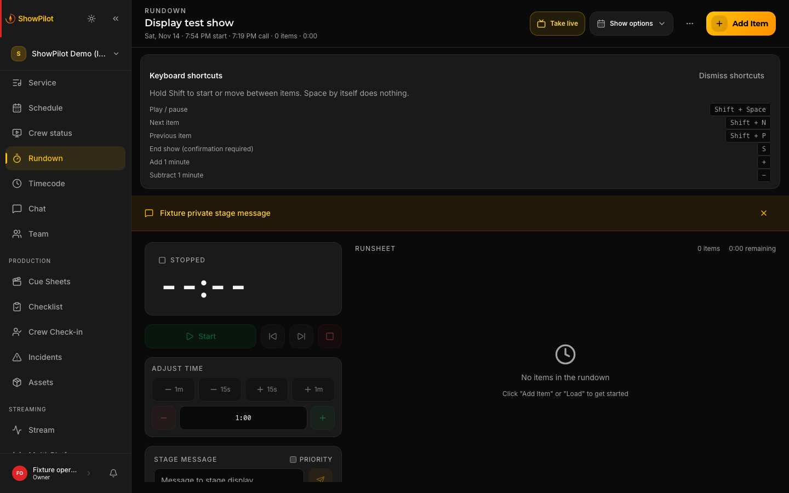

desktop-rundown-unreachable

Before: 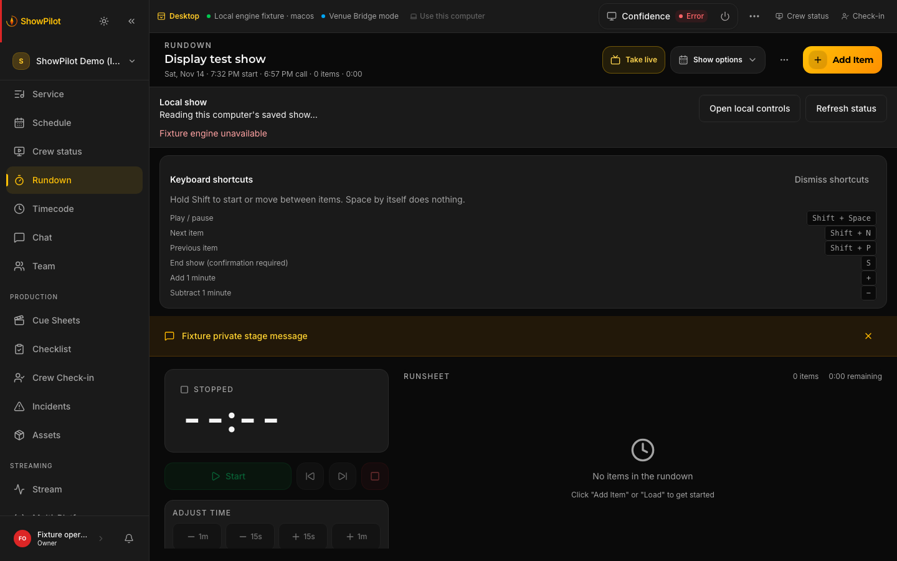

After: 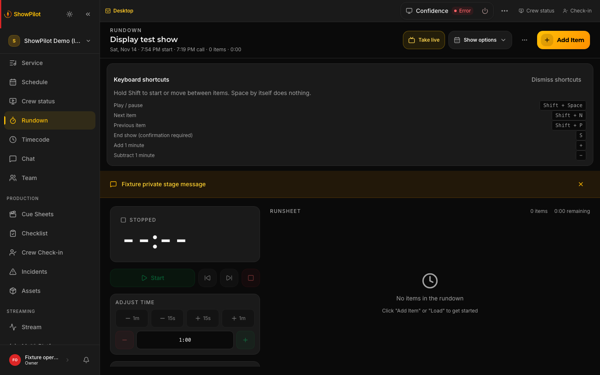

desktop-rundown-active

Before: 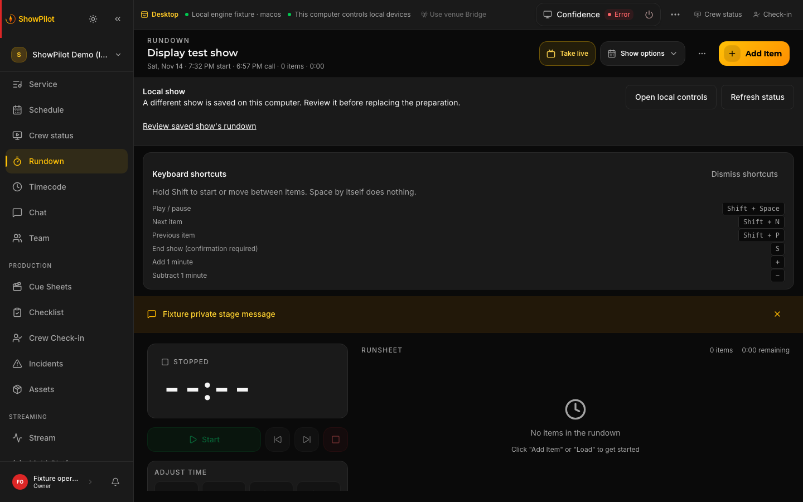

After: 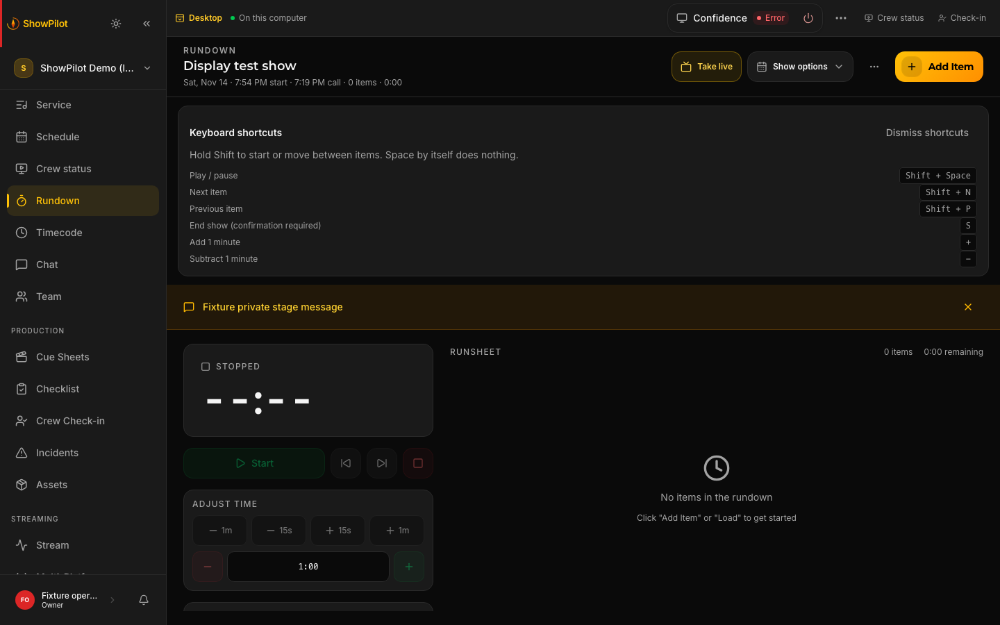

desktop-settings-api

Before: 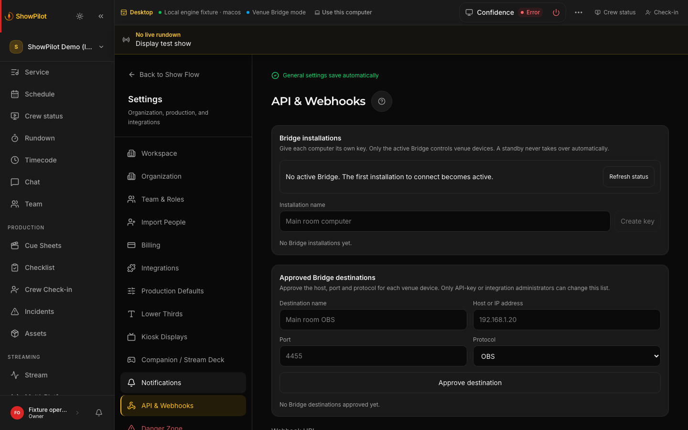

After: 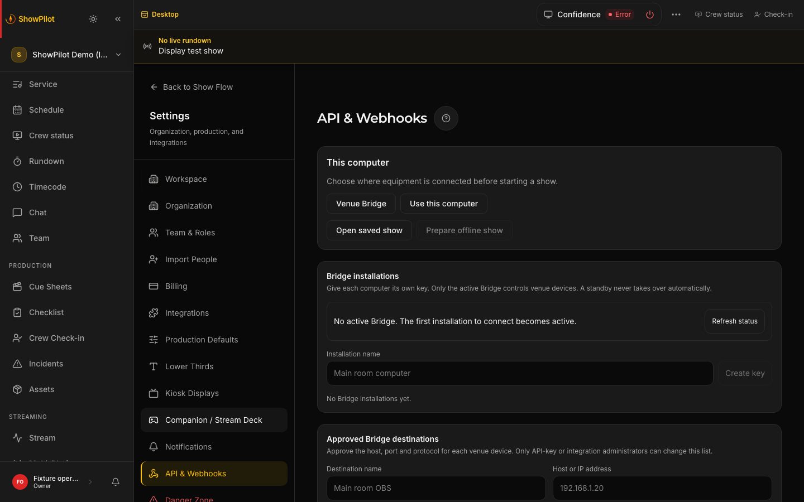

notification-panel

Before: 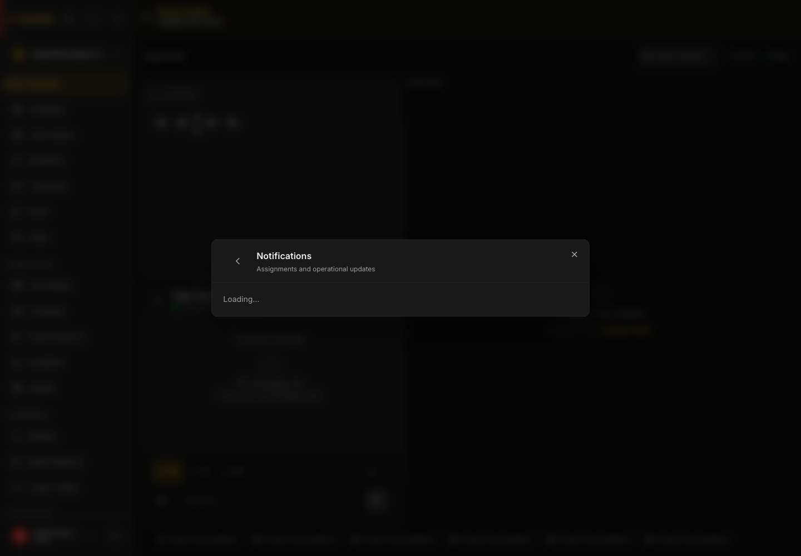

After: 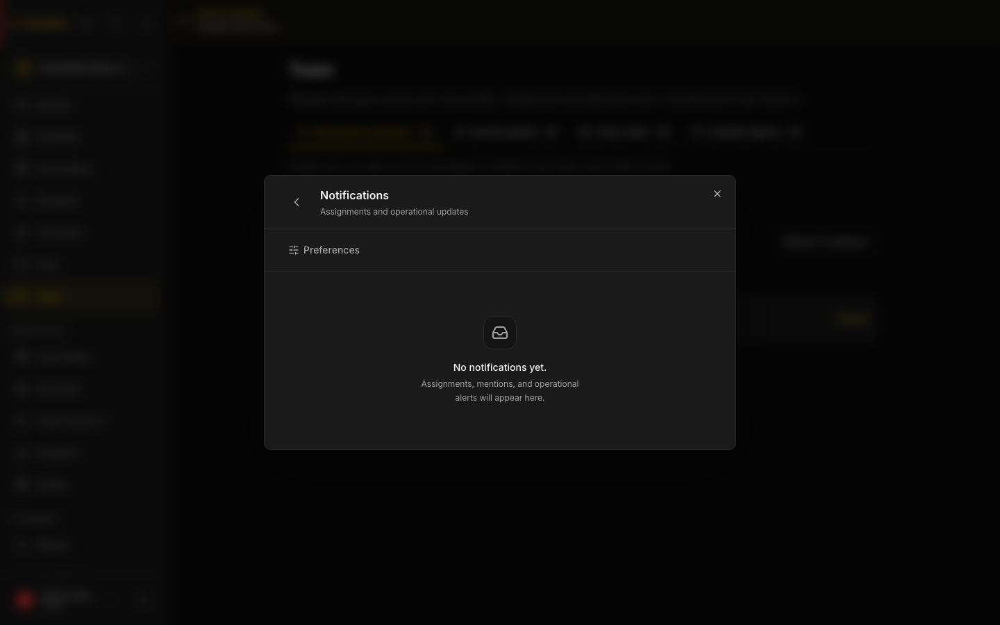

mobile-login-pending

Before: 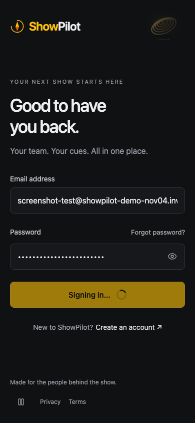

After: 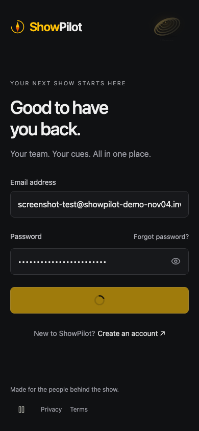

offline-boot

Before: 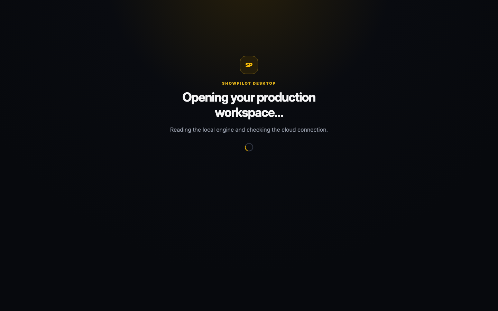

After: 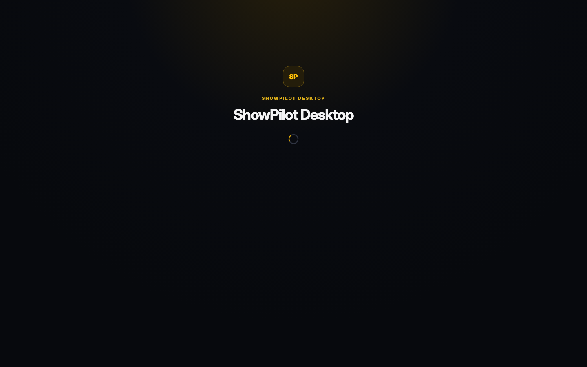

offline-failed

Before: 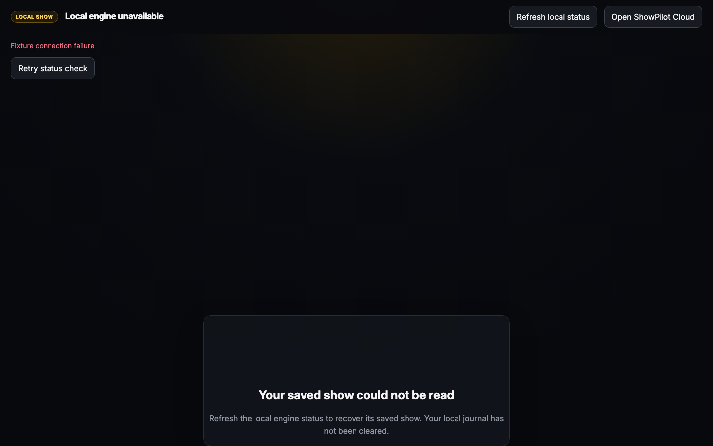

After: 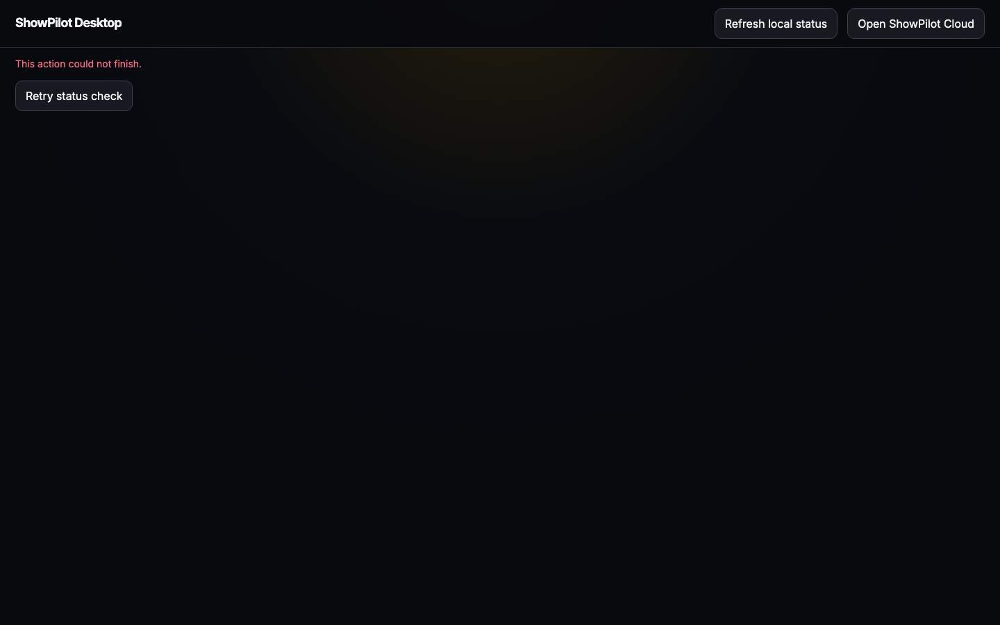

## Exit with the session service blocked

One Sign Out click reached login with `GET /api/auth/get-session` blocked in the disposable fixture browser. The private page disappeared; one plain recovery sentence remained. The automated router regression also holds the service and enables a page blocker.

[Observed result](logout-offline.json) · [Login after local exit](after/logout-offline.png)
